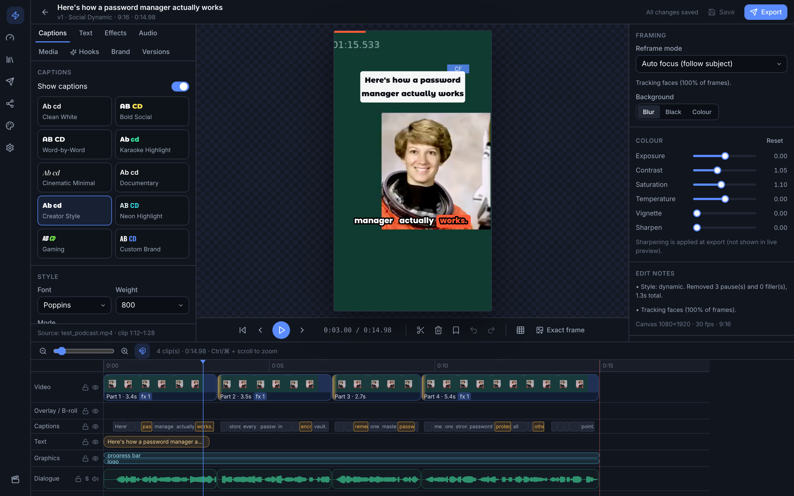
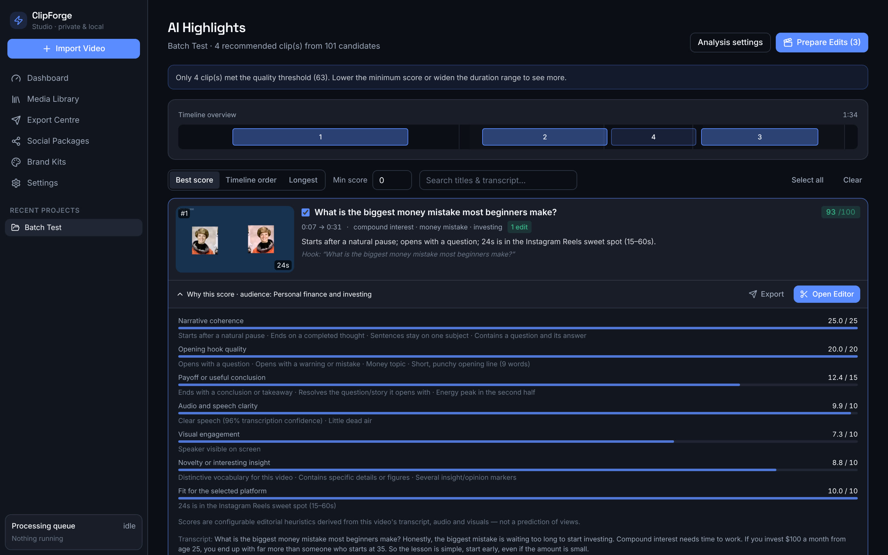
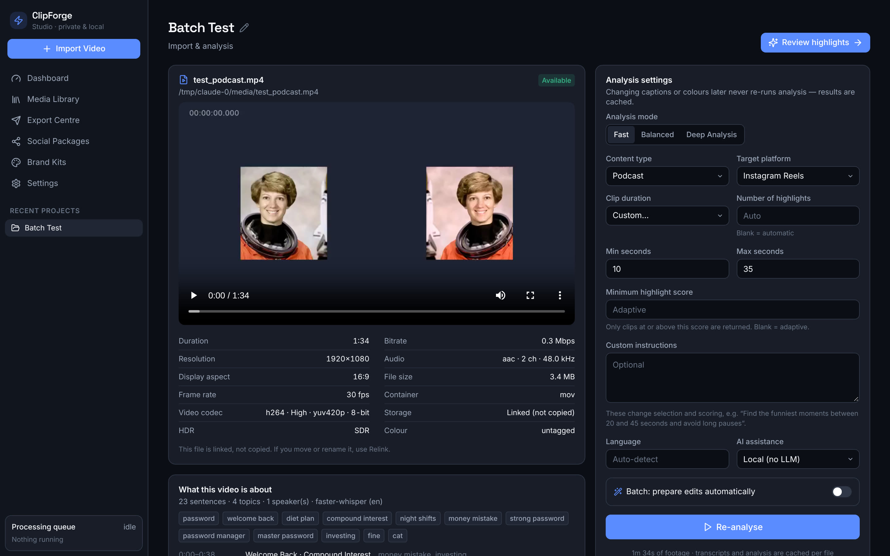
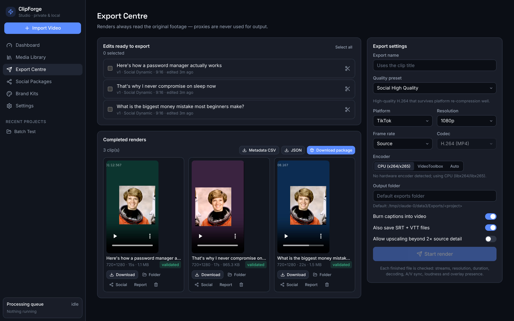
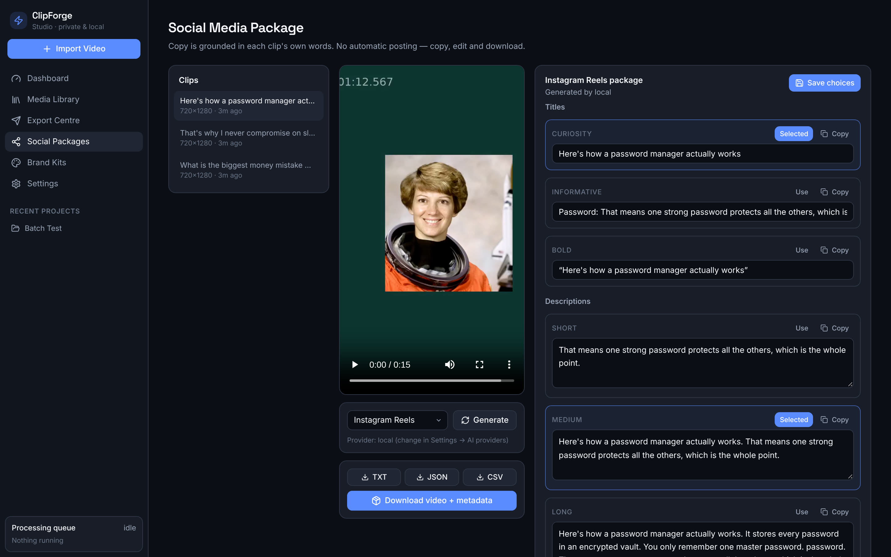

# ClipForge Studio

**A private, local-first AI video clipper.** ClipForge turns long-form video (podcasts, interviews, lessons, streams) into edited short-form clips. It finds the strongest moments with explainable scores, builds an editable timeline with captions, reframing and effects, renders validated high-quality exports, and writes grounded posting copy. Everything runs on your machine. No account, no telemetry, no cloud required.



| AI Highlights | Import & analysis |
|---|---|
|  |  |
| **Export Centre** | **Social package** |
|  |  |

## Quick start (macOS, Apple Silicon or Intel)

```bash
brew install ffmpeg node uv     # FFmpeg (with libass), Node 20+, uv (Python manager)
git clone <this repo> && cd CloudTrace
./clipforge.sh                  # installs, builds the UI, opens http://127.0.0.1:8765
```

On first analysis, faster-whisper downloads the selected speech model once (default `small`, ~480 MB) and then runs offline. If no model can be downloaded, ClipForge falls back to the bundled English pocketsphinx engine and tells you so.

Other commands: `./clipforge.sh dev` (hot reload), `./clipforge.sh test`, `./clipforge.sh e2e`, `./clipforge.sh doctor`.
Full instructions are in [docs/INSTALL.md](docs/INSTALL.md).

## What it does

1. **Import**: drag and drop (multi-file), link a large local file without copying it, or download an authorised URL via yt-dlp. Metadata includes resolution, rotation, VFR, HDR, codecs, bitrate and audio layout.
2. **Analyse**: local transcription with word timestamps, scene cuts (PySceneDetect), faces, motion and saliency (OpenCV), audio energy and silences, topic segmentation, and speaker turns (spectral by default; an optional neural voice encoder can be installed). Results are cached per file fingerprint.
3. **Highlights**: candidates are always whole sentences with context padding, snapped to avoid scene-cut flash frames. Each gets an explainable 0–100 score across 7 configurable factors with evidence. Selection removes overlaps and repetition, balances topics, and returns *fewer* clips rather than weak filler. Content modes (Podcast, Interview, Educational, Gaming, Sports, Entertainment, Business, Custom) and natural-language instructions change the scoring itself.
4. **Edit**: three real editing recipes (Clean Professional, Social Dynamic, Cinematic). Each produces a different timeline: silence and filler removal, punch-ins, grading, captions and audio chain. Regenerate Edit keeps every version.
5. **Editor**: multi-track timeline with trim, split, ripple delete, undo/redo, snapping, markers, thumbnails, waveform, track lock/hide/mute/solo. You also get 10 caption presets with full styling, text layers, graphics, effects, transitions, smart reframing (auto, speaker, split, smart-fill, original, manual keyframes), AI hook suggestions, B-roll suggestions and brand kits. The live preview plays transitions, B-roll and music; **Exact Frame** renders the current frame with the export engine for a pixel-accurate check. Keyframe lane, volume envelopes and per-track gain are edited directly on the timeline.
6. **Render**: one decode-composite-encode pass from the *original* media (never the proxy). Captions are drawn by libass at output resolution, audio gets two-pass loudness normalisation, and there are H.264/HEVC/ProRes presets, VideoToolbox support and honest upscaling reports. Every output is **validated**: streams, resolution, duration, full decode, A/V sync, loudness, and caption/overlay presence in the encoded frames.
7. **Tune**: rate clips 👍/👎 to learn per-mode scoring weights (switched on only when they rank your held-out ratings better), and measure detection against clips you picked by hand with `python -m clipforge.devtools.evaluate`.
8. **Publish kit**: three titles, three descriptions, hashtags, hook text, thumbnail title, keywords and posting notes, all grounded in the clip's own words. Download TXT/JSON/CSV or a ZIP package with videos and SRT/VTT. ClipForge does not post automatically.

## Design principles

- **Real processing only.** No mock data, simulated progress or invented timestamps. Scores are reproducible from the analysis inputs and come with their evidence. If a video has no usable speech, no clips are invented.
- **Quality first.** Originals are never modified. Edits are timelines (JSON), and the final render reads the source once and encodes once. Audio intermediates are lossless.
- **Preview ≈ export.** The backend computes one caption and graphics layout. The browser canvas and the libass exporter draw the *same* list of draw ops with the *same* bundled font files. Crop, keyframe and colour maths are mirrored and checked against shared test fixtures.
- **Private.** The server binds to `127.0.0.1`, rejects foreign Host headers and cross-site requests, and stores API keys in the OS keychain. Cloud AI is opt-in, sends transcript text only, and is labelled wherever it's used.

## Documentation

- [Installation, FFmpeg & model setup, hardware](docs/INSTALL.md)
- [Architecture](docs/ARCHITECTURE.md)
- [Export quality explained](docs/EXPORT_QUALITY.md)
- [Tuning on your own footage: ratings, learned weights, evaluation harness, neural speaker model](docs/TUNING.md)
- [Troubleshooting](docs/TROUBLESHOOTING.md)
- [Features & implementation status (with test evidence) and continuation checklist](docs/STATUS.md)

## Repository layout

```
backend/            Python 3.11+ · FastAPI · SQLite (SQLModel) · FFmpeg/OpenCV/faster-whisper
  clipforge/
    media/          ffprobe inspection, audio features, proxies/thumbnails, streaming visual analysis
    transcribe/     faster-whisper + pocketsphinx engines, caching, SRT/VTT
    analysis/       segmentation, features, candidates, scoring, selection, explanations, modes
    ai/             provider adapters (local / Ollama / Anthropic), schema-validated refinement, key storage
    edit/           timeline recipes, captions/graphics draw-ops, reframing, fonts, edit versions
    render/         compositor, ASS writer, audio mix, encoders, validation, exact-frame preview
    social/         posting-package generation and export bundles
    jobs/           persistent job queue (SSE progress, pause/cancel/retry/resume)
    api/            REST API (localhost-only guards)
  tests/            unit, API, job-queue and real-media video tests (+ test video generator)
frontend/           React 18 · TypeScript · Vite · Tailwind · Zustand · TanStack Query · Radix
  src/editor/       canvas preview compositor, timeline, inspector, panels, editor store
  e2e/              Playwright end-to-end workflow test
shared/             geometry/colour fixtures checked by both test suites
clipforge.sh        single launch command
```

## Licences

ClipForge code: private use. Bundled fonts are SIL Open Font License 1.1 (see `backend/clipforge/assets/fonts/licenses`). FFmpeg, faster-whisper, OpenCV, PySceneDetect, pocketsphinx and yt-dlp keep their own licences. Install them as dependencies. The optional speaker model (Resemblyzer voice encoder) is Apache-2.0, installed only on request, with its licence saved next to the weights. Use only media you own or are licensed to edit.
