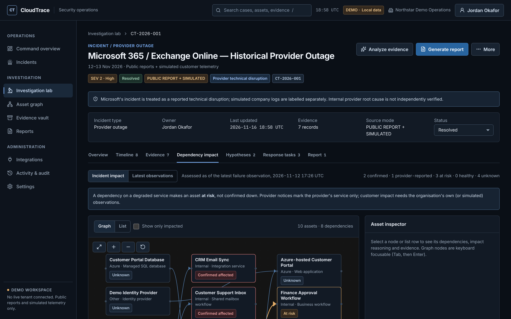

# CloudTrace

**Understand the failure. Trace the evidence. Protect the business.**

CloudTrace is an investigation-first web application for cloud incidents. It correlates provider reports and organisation evidence with a service-dependency graph, separates *confirmed affected* from *at risk*, tracks hypotheses and manual response tasks, and produces immutable, evidence-referenced reports. It runs entirely locally: no Azure, Microsoft or paid AI credentials are required.

> Demo data: the seeded workspace combines **public historical reports** of the 12–13 November 2026 Microsoft 365 / Exchange Online disruption (EX1550543 / MO1550821) with **simulated** telemetry from a fictional company. It is not a live Microsoft investigation, and the outage is treated as a provider-reported technical issue, not an attack.



## Quick start

Requirements: Node.js 20.9+ (tested on Node 22) and npm.

```bash
npm install
cp .env.example .env
# Edit .env: set AUTH_SECRET (32+ random chars) and DEMO_SEED_PASSWORD (12+ chars, not the placeholder)
node -e "console.log(require('crypto').randomBytes(32).toString('base64url'))"   # → AUTH_SECRET

npm run db:push     # create the local SQLite schema (prisma/dev.db)
npm run db:seed     # load demo organisation, users and scenarios (safe to re-run)
npm run dev         # http://localhost:3000
```

Sign in with any seeded account; the password is the `DEMO_SEED_PASSWORD` you set in `.env`:

| Account | Role | Can |
|---|---|---|
| `owner@cloudtrace.local` | Owner | Everything, including workspace settings, roles and Microsoft sync |
| `analyst@cloudtrace.local` | Analyst | Create and edit incidents, evidence, hypotheses, tasks, analysis, reports |
| `viewer@cloudtrace.local` | Viewer | Read-only (server returns 403 for every write) |
| `isolation.owner@cloudtrace.local` | Owner of a **second** organisation | Used to verify cross-tenant isolation |

Production build: `npm run build && npm run start`.

## Scripts

| Script | Purpose |
|---|---|
| `npm run dev` | Development server |
| `npm run build` / `npm run start` | Production build / server |
| `npm run lint` | ESLint (Next.js + TypeScript rules; `dangerouslySetInnerHTML` is an error) |
| `npm run typecheck` | `tsc --noEmit` (strict mode) |
| `npm run test` | Vitest unit + integration tests (integration tests use a throwaway `prisma/test.db`) |
| `npm run test:e2e` | Playwright end-to-end tests against a production build on a throwaway `prisma/e2e.db`. Run `npm run build` first. |
| `npm run db:push` | Create/update the SQLite schema |
| `npm run db:seed` | Idempotent demo seed. Refuses placeholder/short passwords and `NODE_ENV=production` (unless `ALLOW_DEMO_SEED=true`). |
| `npm run db:reset` | **Development only — deletes all local data.** Recreates the schema; run `db:seed` afterwards. Refuses non-SQLite URLs and production. |

## Seeded scenarios

- **CT-2026-001 — Microsoft 365 / Exchange Online — Historical Provider Outage** (`PROVIDER_OUTAGE`, `PROVIDER_TECHNICAL`, SEV 2, Resolved). Public provider notices (with source links) plus simulated CRM and helpdesk failures. The dependency map shows Exchange Online as *provider reported*, CRM Email Sync and Customer Support Inbox as *confirmed affected* (simulated), Outlook / Teams Calendar / Finance Approval as *at risk*, and the Azure-hosted Customer Portal as *unknown* (no dependency on Exchange). Includes two hypotheses (provider-side issue *supported* with a caveat; intrusion *rejected*), three tasks, an initial rule-based analysis and report v1.
- **CT-2026-002 — Unusual Authentication Pattern — Fictional Tenant** (`SECURITY_SUSPECTED`, Investigating). 100% simulated sign-in events using documentation IP ranges (192.0.2.0/24, 198.51.100.0/24). Never labelled as a confirmed compromise.
- **CT-2026-003 — Portal API errors after gateway policy change** (`CONFIGURATION`, Monitoring). Simulated Azure change-related degradation, showing the platform is not Microsoft-365-specific.

The reference fixtures in `fixtures/` (`public_plus_simulated_case.json`, `synthetic_signins.csv`) import cleanly; because the seed already contains those records, the import preview reports them as duplicates, which demonstrates de-duplication.

## Using the app

- **Command overview**: KPIs computed from stored records, event activity by provenance, evidence-quality checks, priority incidents, audit activity and connection status.
- **Incidents**: search, filter (severity / status / type), sort and paginate; create a case. Filters live in the URL.
- **Investigation lab** (`/investigations/[id]`, also `/incidents/[id]`): seven tabs — Overview, Timeline, Evidence, Dependency impact, Hypotheses, Response tasks, Report — kept in `?tab=`. Evidence inspectors open with `?evidence=<id>` so any “view evidence” link is a deep link.
- **Asset graph**: graph/inventory views, add assets and dependencies (consumer DEPENDS_ON provider), cycle warnings, and an incident overlay.
- **Evidence vault**: cross-incident search (title, source, case, asset, `EV-0001`, SHA-256 prefix) and the CSV/JSON import wizard (preview → validation → all-or-nothing or partial → result).
- **Reports**: immutable versioned snapshots with Print / save as PDF (browser print), JSON export and timeline CSV export.
- **Integrations**: truthful status for the local engine, Microsoft 365 service health and Claude analysis.
- **Activity & audit**: append-only audit log with filters, metadata inspector and CSV export (analysts and owners).
- **Settings**: workspace name, members and roles, local demo-user creation (development only), profile.

### Import format

CSV headers (exact minimum): `incidentCaseNumber,observedAt,title,category,sourceName,sourceEventId,assetName,provenance,contentText,sourceUri`. Optional: `confidenceLevel`, `assetStatus` (`HEALTHY|DEGRADED|DOWN`, asserts the linked asset's health). JSON is an array of objects with the same keys. Timestamps must be ISO-8601 with a time zone. `PUBLIC_REPORTED` rows must cite a `sourceUri`. Max 5 MiB / 5,000 rows.

## Optional integrations

Both are disabled until configured, and the app never shows them as connected without a verified state.

- **Claude analysis**: set `ANTHROPIC_API_KEY` (and optionally `CLAUDE_MODEL`, default `claude-opus-5-5`). Analysis sends evidence abstracts for one incident to the Messages API (server-side), validates the structured response, and drops any claim that does not cite submitted evidence. Any failure (network, auth, refusal, invalid output) falls back to the deterministic rule-based analysis and records the reason.
- **Microsoft 365 service health (read-only)**: register an Entra app with the **application** permission `ServiceHealth.Read.All` (admin consent), then set `MS_TENANT_ID`, `MS_CLIENT_ID`, `MS_CLIENT_SECRET` and `MS_CONNECTOR_ORGANIZATION_SLUG` (the workspace it serves, e.g. `northstar-demo`). An owner runs **Sync now** on the Integrations page. Retrieved issues can be attached to a case as customer-observed evidence; they never mark assets as down automatically.

## Troubleshooting

- **“DEMO_SEED_PASSWORD must be set…”**: set a unique value of at least 12 characters in `.env`.
- **Sign-in says “Too many sign-in attempts”**: the local rate limiter allows 8 attempts per email per 15 minutes. Restart the server to clear it in development.
- **Prisma cannot find the database**: run `npm run db:push`. `DATABASE_URL` is relative to `prisma/` (`file:./dev.db` → `prisma/dev.db`).
- **Playwright cannot find a browser**: run `npx playwright install chromium` (not needed where a browser is preinstalled).
- **Running `next dev` next to a production build**: set `NEXT_DIST_DIR=.next-dev` for the dev server so it does not overwrite `.next`.

## Documentation

- `CLAUDE.md`: functional, security and data-integrity specification.
- `docs/spec/CLOUDTRACE_OBSIDIAN_DESIGN_SPEC.md` (+ tokens, CSS, checklists): approved Obsidian design system.
- `IMPLEMENTATION_NOTES.md`: what is complete, design decisions, verification results and known limitations.
- `docs/screenshots/`: screenshots of the main screens.

**Not production-certified.** SQLite, in-memory rate limiting and environment-variable secrets suit a local or portfolio MVP. See `IMPLEMENTATION_NOTES.md` before deploying anywhere internet-facing.
